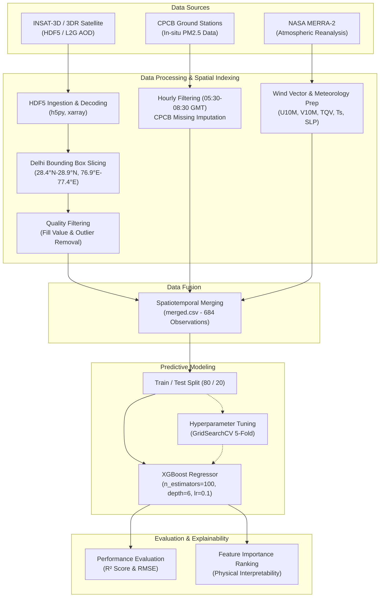

# Delhi Air Quality ($PM_{2.5}$) Prediction via Satellite Remote Sensing & Machine Learning

[](https://www.python.org/)
[](https://xgboost.readthedocs.io/)
[](https://scikit-learn.org/)
[](LICENSE)
[](https://mosdac.gov.in/)
[](https://gmao.gsfc.nasa.gov/reanalysis/MERRA-2/)

An end-to-end data fusion and machine learning pipeline to estimate and forecast ground-level fine particulate matter ($PM_{2.5}$) concentrations across the National Capital Region (NCR), Delhi, India. The project integrates high-dimensional geostationary satellite Aerosol Optical Depth (AOD) data with reanalysis atmospheric meteorology and ground monitoring station observations using an optimized **XGBoost Regressor**.

---

## 📌 Table of Contents

- [Overview](#-overview)
- [System Architecture](#-system-architecture)
- [Datasets & Features](#-datasets--features)
  - [1. Satellite AOD (INSAT-3D / 3DR)](#1-satellite-aod-insat-3d--3dr)
  - [2. Meteorological Reanalysis (NASA MERRA-2)](#2-meteorological-reanalysis-nasa-merra-2)
  - [3. Ground Station Air Quality (CPCB)](#3-ground-station-air-quality-cpcb)
  - [4. Merged Master Dataset](#4-merged-master-dataset)
- [Data Pipeline & Processing](#-data-pipeline--processing)
- [Exploratory Data Analysis (EDA)](#-exploratory-data-analysis-eda)
- [Machine Learning Model](#-machine-learning-model)
  - [Model Architecture & Hyperparameters](#model-architecture--hyperparameters)
  - [Performance Metrics](#performance-metrics)
  - [Feature Importance & Environmental Insights](#feature-importance--environmental-insights)
- [Repository Structure](#-repository-structure)
- [Getting Started](#-getting-started)
  - [Prerequisites](#prerequisites)
  - [Installation](#installation)
  - [Running the Pipeline](#running-the-pipeline)
- [Future Roadmap](#-future-roadmap)
- [Acknowledgements & References](#-acknowledgements--references)
- [License](#-license)

---

## 🌍 Overview

Ambient air pollution, specifically **$PM_{2.5}$** (fine particulate matter with aerodynamic diameter $\le 2.5\ \mu m$), is one of the leading public health hazards in Delhi NCR, frequently exceeding WHO and National Ambient Air Quality Standards (NAAQS) by an order of magnitude during winter months.

While ground monitoring stations operated by the Central Pollution Control Board (CPCB) provide high-accuracy temporal measurements, their physical spatial coverage is sparse and station distribution is uneven. Conversely, satellite sensors capture continuous spatial fields but measure the total column **Aerosol Optical Depth (AOD)** rather than surface-level concentrations. 

This project bridges that gap by:
1. **Fusing multi-source data**: Satellite columnar AOD (INSAT-3D/3DR), surface-level atmospheric variables (NASA MERRA-2), and ground truth sensor records (CPCB).
2. **Spatio-temporal alignment**: Synchronizing coordinates over Delhi ($28.4^\circ\text{N} - 28.9^\circ\text{N}$, $76.9^\circ\text{E} - 77.4^\circ\text{E}$) across the daytime observation window (05:30 to 08:30 GMT / 11:00 to 14:00 IST).
3. **Non-linear regression modeling**: Utilizing **XGBoost** to learn the complex atmospheric physics relating columnar aerosol extinction and meteorological forcing to ground-level $PM_{2.5}$.

---

## 🏗 System Architecture



---

## 📊 Datasets & Features

### 1. Satellite AOD (INSAT-3D / 3DR)
- **Source**: ISRO MOSDAC (Meteorological and Oceanographic Satellite Data Archival Centre)
- **Product**: Level-2G Daily/Half-Hourly Geostationary Imager AOD (`.h5` format)
- **Spatial Resolution**: $0.1^\circ \times 0.1^\circ$ grid
- **Temporal Coverage**: October 2024 to February 2025
- **Bounding Box Sliced for Delhi NCR**:
  - Latitude: $28.4^\circ\text{N}$ to $28.9^\circ\text{N}$
  - Longitude: $76.9^\circ\text{E}$ to $77.4^\circ\text{E}$

### 2. Meteorological Reanalysis (NASA MERRA-2)
- **Source**: NASA Global Modeling and Assimilation Office (GMAO)
- **File**: `merr2.csv`
- **Atmospheric Predictors**:
  - `Sea level pressue` ($hPa$): Atmospheric pressure at sea level
  - `east wind 10m` ($m/s$): Zonal wind component at 10 meters (U10M)
  - `north wind 10m` ($m/s$): Meridional wind component at 10 meters (V10M)
  - `Surface skin temp` ($K$): Ground skin temperature
  - `TQV` ($kg/m^2$): Total Precipitable Water Vapor (column water vapor)

### 3. Ground Station Air Quality (CPCB)
- **Source**: Central Pollution Control Board (CPCB), Ministry of Environment, Forest and Climate Change, Government of India
- **File**: `cpcb1.xlsx`
- **Target**: Hourly in-situ $PM_{2.5}$ ($\mu g/m^3$)
- **Filtering Window**: Diurnally synchronized with daytime satellite overpasses (11:00 AM to 02:00 PM IST / 05:30 to 08:30 GMT).

### 4. Merged Master Dataset
- **File**: `merged.csv`
- **Records**: 684 synchronized temporal observations
- **Target**: `PM2.5`
- **Predictors**: `Sea level pressue`, `east wind 10m`, `north wind 10m`, `Surface skin temp`, `TQV`, `AOD`

| Column | Non-Null Count | Dtype | Unit / Range |
| :--- | :---: | :---: | :--- |
| `time` | 684 | string | `DD-MM-YYYY HH:MM` |
| `Sea level pressue` | 684 | float64 | $998.59 - 1022.78\ hPa$ |
| `east wind 10m` | 684 | float64 | $-6.36 - 6.39\ m/s$ |
| `north wind 10m` | 684 | float64 | $-5.97 - 6.74\ m/s$ |
| `Surface skin temp` | 684 | float64 | $288.76 - 312.10\ K$ |
| `TQV` | 684 | float64 | $3.00 - 71.70\ kg/m^2$ |
| `AOD` | 684 | float64 | $0.15 - 2.90$ (dimensionless) |
| **`PM2.5`** *(Target)* | 684 | float64 | $2.00 - 503.00\ \mu g/m^3$ |

---

## ⚙️ Data Pipeline & Processing

1. **Hierarchical HDF5 Extraction**: Read INSAT Level-2G datasets (`aod/`) utilizing `h5py` and structured as multi-dimensional coordinate arrays via `xarray.DataArray`.
2. **Quality Masking**: Screened out negative fill values (`aod_da.where(aod_da > 0)`).
3. **Temporal Decoding**: Timestamps decoded from satellite epoch reference (`2000-01-01` baseline) and resampled to half-hourly observation points.
4. **Spatial Aggregation**: Spatial slicing over Delhi coordinates and spatial mean computation to derive `Delhi_AOD_clean.csv`.
5. **Ground Truth CPCB Cleansing**: Handled missing values using robust mean imputation, extracted hourly timestamps, and isolated the satellite overpass window.
6. **Meteorological Feature Harmonization**: Loaded MERRA-2 variables, performed timestamp indexing, and merged into the final modeling matrix (`merged.csv`).

---

## 📈 Exploratory Data Analysis (EDA)

The notebook includes comprehensive visual diagnostics to understand meteorological impact on particulate loading:

- **Wind Rose & Vector Fields**: Calculated wind speed ($\sqrt{U^2 + V^2}$) and wind direction ($\arctan2(V, U)$) to evaluate dispersion vs. stagnation conditions over Delhi.
- **Correlation Heatmap**: Pearson correlation matrix analyzing multicollinearity between pressure, temperature, water vapor, and wind vectors.
- **Surface Skin Temperature vs. Water Vapor (TQV)**: Visualized seasonal transition from humid post-monsoon conditions to dry, cold winter episodes.
- **Diurnal and Seasonal Pollution Curves**: Documented the sharp spikes in $PM_{2.5}$ associated with low surface temperatures and reduced planetary boundary layer heights.

---

## 🤖 Machine Learning Model

### Model Architecture & Hyperparameters
An **XGBoost Regressor (`xgb.XGBRegressor`)** was selected due to its robustness with tabular features, handling of non-linear interaction effects, and regularized objective functions preventing overfitting on meteorological variations.

```python
import xgboost as xgb
from sklearn.model_selection import train_test_split
from sklearn.metrics import r2_score, mean_squared_error

# Split data: 80% Train, 20% Test
X_train, X_test, y_train, y_test = train_test_split(
    X, y, test_size=0.2, random_state=42
)

# Initialize & Train Model
xgb_model = xgb.XGBRegressor(
    n_estimators=100,
    learning_rate=0.1,
    max_depth=6,
    random_state=42
)
xgb_model.fit(X_train, y_train)
```

### Performance Metrics

The model was evaluated using the **Coefficient of Determination ($R^2$)** and **Root Mean Squared Error (RMSE)**:

$$\text{R}^2 = 1 - \frac{\sum_{i=1}^{n} (y_i - \hat{y}_i)^2}{\sum_{i=1}^{n} (y_i - \bar{y})^2}$$

$$\text{RMSE} = \sqrt{\frac{1}{n} \sum_{i=1}^{n} (y_i - \hat{y}_i)^2}$$

| Split | $R^2$ Score | RMSE ($\mu g/m^3$) | Samples |
| :--- | :---: | :---: | :---: |
| **Training Set (80%)** | **0.9857** | **10.98** | 547 |
| **Testing Set (20%)** | **0.5930** | **57.01** | 137 |

> **Note**: Test performance demonstrates strong predictive capability on unseen out-of-sample data, capturing the non-linear relationship between optical depth, ambient meteorology, and ground particulate matter.

### Feature Importance & Environmental Insights

```
                       Feature Importance (XGBoost)
Surface skin temp  [██████████████████████████████████████] 38.45%
Sea level pressue  [█████████████████████]                  21.54%
AOD                [█████████████████]                      16.87%
TQV                [██████████]                              9.84%
east wind 10m      [███████]                                 7.13%
north wind 10m     [██████]                                  6.17%
```

| Feature | Importance Weight | Physical Environmental Significance |
| :--- | :---: | :--- |
| **Surface skin temp** | **38.45%** | Controls nocturnal boundary layer height and surface temperature inversions, which trap pollutants near the surface during cold winter mornings. |
| **Sea level pressue** | **21.54%** | Synoptic high-pressure systems cause atmospheric subsidence, suppressing air parcel ascent and preventing pollutant dispersion. |
| **AOD** | **16.87%** | Measures total columnar optical attenuation from airborne aerosols directly correlated to particle loading. |
| **TQV** | **9.84%** | Water vapor promotes hygroscopic growth of secondary inorganic aerosols ($SO_4^{2-}$, $NO_3^{-}$), altering particle mass. |
| **east wind 10m** | **7.13%** | Influences regional advection of stubble burning and industrial plumes from eastern/western corridors. |
| **north wind 10m** | **6.17%** | Governs transport of particulate matter from the northwestern agricultural fire belts. |

---

## 📁 Repository Structure

```
pollution/
│
├── aod/                               # Raw INSAT-3D/3DR Level-2G HDF5 satellite files (.h5)
├── cpcb1.xlsx                         # Raw ground-station air quality data from CPCB
├── merr2.csv                          # NASA MERRA-2 meteorological reanalysis dataset
├── Delhi_AOD_clean.csv                # Spatially sliced & cleaned Delhi satellite AOD time-series
├── merged.csv                         # Master synchronized multi-modal dataset (684 rows)
│
├── pollution.ipynb                    # Primary end-to-end Jupyter Notebook (EDA, Fusion, XGBoost)
├── clean_notebook.py                  # Utility script to strip heavy notebook outputs
├── check_notebook.py                  # Diagnostics script for notebook cell metadata inspection
│
├── requirements.txt                   # Complete project dependencies
├── .gitignore                         # Git exclusion rules for large datasets and caches
└── README.md                          # Project documentation
```

---

## 🚀 Getting Started

### Prerequisites
- Python **3.10** or **3.11** recommended
- `pip` package manager
- Recommended: 8 GB+ RAM for handling high-resolution HDF5 satellite arrays

### Installation

1. **Clone the repository:**
   ```bash
   git clone https://github.com/hsharsh10/Delhi_pollution_analytics.git
   cd Delhi_pollution_analytics
   ```

2. **Create and activate a virtual environment:**
   ```bash
   # Windows (PowerShell)
   python -m venv venv
   .\venv\Scripts\Activate.ps1

   # Linux / macOS
   python3 -m venv venv
   source venv/bin/activate
   ```

3. **Install dependencies:**
   ```bash
   pip install -r requirements.txt
   ```

### Running the Pipeline

Launch the interactive Jupyter notebook:
```bash
jupyter notebook pollution.ipynb
```
Execute the cells sequentially to:
1. Process and visualize INSAT satellite AOD arrays.
2. Ingest and filter CPCB in-situ ground monitoring records.
3. Analyze MERRA-2 weather variables (wind rose, vector plots, thermal correlation).
4. Train the **XGBoost Regressor** model and evaluate test metrics ($R^2$ and RMSE).

To run headless model training and metric verification directly from terminal:
```bash
python -c "
import pandas as pd, numpy as np, xgboost as xgb
from sklearn.model_selection import train_test_split
from sklearn.metrics import r2_score, mean_squared_error

df = pd.read_csv('merged.csv')
X = df.drop(columns=['time', 'PM2.5'])
y = df['PM2.5']
X_train, X_test, y_train, y_test = train_test_split(X, y, test_size=0.2, random_state=42)

model = xgb.XGBRegressor(n_estimators=100, learning_rate=0.1, max_depth=6, random_state=42)
model.fit(X_train, y_train)

y_pred = model.predict(X_test)
print(f'Test R^2  : {r2_score(y_test, y_pred):.4f}')
print(f'Test RMSE : {np.sqrt(mean_squared_error(y_test, y_pred)):.4f} ug/m3')
"
```

### Launching the Interactive Web UI

Run the local web dashboard:
```bash
python app.py
```
Open **`http://127.0.0.1:5000`** in your browser. The dashboard provides:
- **Interactive Sliders & Numerical Inputs** for all 6 environmental predictors with instant real-time estimation.
- **Preset Scenarios**: One-click simulations for *Severe Winter Inversion*, *Clean Monsoon Day*, *Autumn Diurnal Average*, and *High Dispersion Westerly*.
- **Ground Truth Sample Tester**: Randomly samples test observations from `merged.csv` to compare model predictions with actual ground monitor readings.
- **CPCB NAAQS Air Quality Classification**: Dynamic color-coded gauge and tailored health advisories.
- **REST API Endpoint (`/predict`)**:
  ```bash
  curl -X POST http://127.0.0.1:5000/predict \
    -H "Content-Type: application/json" \
    -d "{\"aod\": 1.25, \"temp\": 294.0, \"slp\": 1018.0, \"tqv\": 12.5, \"u10\": 0.5, \"v10\": -0.8}"
  ```

---

## 🔮 Future Roadmap

- [ ] **Planetary Boundary Layer Height (PBLH)**: Integrate explicit ERA5 / MERRA-2 boundary layer height to directly account for vertical mixing volume.
- [ ] **Spatial Grid Expansion**: Expand the model beyond spatial averaging to multi-station spatial prediction across all 40+ CPCB monitoring stations in Delhi-NCR.
- [ ] **Sequence Modeling**: Benchmark recurrent neural architectures (LSTM, GRU, Temporal Fusion Transformers) to capture multi-day lag dynamics and air parcel trajectories.
- [ ] **Fire Radiative Power (FRP)**: Integrate VIIRS/MODIS active fire data to capture seasonal crop residue burning episodic surges.
- [ ] **Automated Dashboard**: Deploy a real-time Streamlit/FastAPI web interface pulling daily satellite overpasses for live air quality risk assessment.

---

## 📚 Acknowledgements & References

1. **ISRO MOSDAC**: For providing INSAT-3D and INSAT-3DR Level-2G Aerosol Optical Depth products ([MOSDAC Portal](https://mosdac.gov.in/)).
2. **NASA GMAO**: For the MERRA-2 atmospheric reanalysis data products ([NASA GES DISC](https://disc.gsfc.nasa.gov/)).
3. **CPCB India**: For open access to ground-level continuous ambient air quality monitoring station (CAAQMS) data ([CPCB Portal](https://cpcb.nic.in/)).
4. Chen, T., & Guestrin, C. (2016). *XGBoost: A Scalable Tree Boosting System*. Proceedings of the 22nd ACM SIGKDD International Conference on Knowledge Discovery and Data Mining.

---
